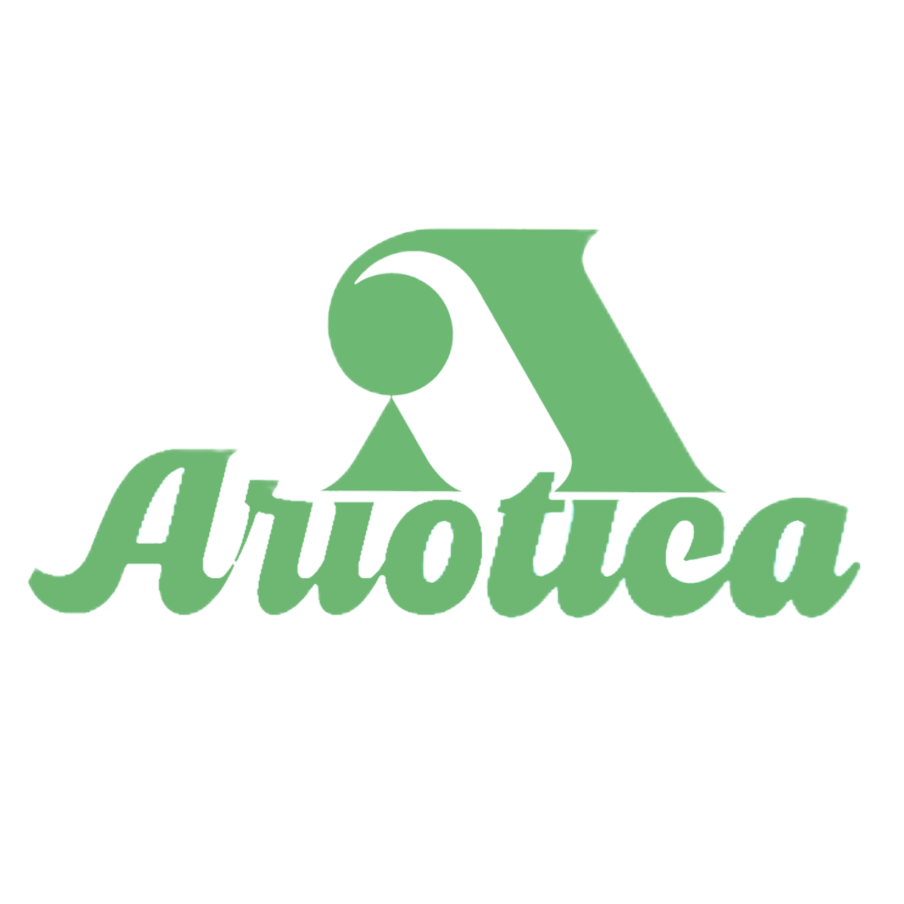

<div align="center">




<a href="https://suryasticsai.github.io/Ariotica/">
  
</a>

<br/>

[](https://suryasticsai.github.io/Ariotica/)
[](https://github.com/suryasticsai/Ariotica/issues/new)


</div>

---

<div align="center">

  <p><b>A live AI developer that lives in your GitHub repo. Issues in, working apps out.</b></p>

  [](https://github.com/suryasticsai/Ariotica/actions/workflows/test.yml)
  [](https://github.com/suryasticsai/Ariotica/actions/workflows/ai-cron.yml)

</div>

---

## 🚀 What is Ariotica?

Ariotica is not a wrapper around an LLM. It's a **fully autonomous software engineering pipeline** that lives entirely inside a GitHub Actions runner. Every app is built, tested in a headless browser, security-scanned, and deployed — with **zero servers, zero databases, and zero frameworks**.

It's the kind of agent that manages its own deployments, tracks its own API costs, maintains its own version history, and **learns from its own mistakes**.

---

## ✨ The Super Features

### 👁️ Cyclops QA — Full Visual & Runtime Auditing
Before any app is committed, it must survive **Cyclops** — the agent's autonomous QA engineer.
- **Headless Playwright Browser:** The app is loaded in a real Chromium instance (1280×800 desktop, then 375×812 mobile).
- **Runtime Error Capture:** Catches every `console.error`, uncaught exception, and failed network request.
- **Structural Validation:** Detects horizontal overflow (the #1 mobile layout killer), missing page titles, and broken asset loading.
- **Visual Critique:** Groq's `llama-3.2-11b-vision-instruct` (the current production model) analyzes the screenshot and returns a list of CSS/HTML fixes.
- **Automatic Repair:** The AI receives both the critique and any runtime errors, then patches the code and re-tests.

### 🏁 Model Racing with Health Checks
Ariotica doesn't trust a single LLM. Four providers receive the prompt **simultaneously**:
- **Groq** (fastest, `openai/gpt-oss-120b`)
- **Skritimai** (your private Kaggle engine via Cloudflare Worker)
- **GitHub Models** (`gpt-4o-mini`, `DeepSeek-R1`)
- **OpenRouter** (free tier models)

**The first model to pass Cyclops wins the race.** The others are instantly cancelled to save tokens. If a provider returns 503/502/429, it's put on cooldown or permanently disabled for that run.

### 🧠 Skritimai — Your Private, Free, GPU-Powered Brain
Ariotica integrates with **Skritimai**, an OpenAI-compatible Cloudflare Worker that proxies your Kaggle GPU notebook.
- **Fast-Skip Health Check:** Every build pings `/v1/models` in 2.5s. If Kaggle is asleep, the response is 503, and Skritimai is dropped from the race instantly (no blocking).
- **Zero Paid Tokens:** When Kaggle is awake, Skritimai competes with Groq for free — saving your Groq quota for later.
- **Direct URL Mode:** No more Gist polling. Just `SKRITIMAI_BASE_URL` → Cloudflare Worker → Kaggle.
- **Timeout-Tuned:** `SKRITIMAI_TIMEOUT_MS` (default 180s) lets your Kaggle instance finish even on slow cold starts.

### 🎨 The Template Guardrail Engine
The AI **cannot** destroy your layout.
- **Letterhead Base:** Every app inherits a beautiful, dark-mode, mobile-first template.
- **Stripped Prompt Injection:** The prompt only shows the HTML *structure* (~4,700 chars) — the massive `<style>` block is auto-injected server-side, saving ~4,000 tokens per request.
- **CSS Override Cascade:** If the AI forgets to include the CSS, the full template CSS is prepended automatically. AI overrides still win via cascade.
- **Hallucination Scrubber:** Strips any `integrity="..."` hashes the AI invents (which would block fonts/CDN loading).

### 📱 True PWA with Content-Hashed Caching
Every app is automatically an installable Progressive Web App.
- **Auto-Injected Manifest:** Generates `manifest.json`, `sw.js`, and AI-generated icons (Pollinations → DiceBear fallback).
- **Content-Hashed Cache:** The service worker cache name is a `sha256` hash of `index.html + style.css + script.js + manifest.json + icons`. When the app updates, users get the new version instantly — no more "stuck on v1" bugs.
- **Offline-First:** Cache-first for assets, network-first for HTML navigation.

### ⚡ Atomic Git Operations
Zero risk of corrupting the repo.
- **Single-Commit Trees:** Uses the GitHub Trees API to create one atomic commit containing all files. If the build fails mid-way, **nothing** is committed.
- **Atomic Deletion:** `deletedPaths` support — the `[delete]` command removes the entire app folder + PWA files + receipt in a single commit.
- **Stale-Checkout Killer:** After any API commit, `syncCheckout()` force-syncs the local runner so the Knowledge Index and Artifacts are always fresh.
- **No Destructive Rollbacks:** We never `git reset --hard`. Parallel builds can't wipe each other out.

### 🧠 RAG Knowledge Engine (BM25)
Ariotica remembers every app it has ever built.
- **BM25 Search:** Every file, issue, and skill is indexed into `knowledge/index.json`.
- **Skill Synthesis:** Paste a URL, and Ariotica scrapes it, writes a markdown cheatsheet, and saves it to `knowledge/skills/` for future builds.
- **Draft vs. Verified:** New skills start as `draft` — the AI can't rely on them until a human promotes them to `verified`.

### 🛡️ Built-in Security (SAST)
- **Trusted Domains Allowlist:** Only approved CDNs (Bootstrap, Chart.js, PeerJS) can be loaded.
- **SRI Pinning:** Every external script is verified with SHA-384.
- **Dynamic CSP:** Content-Security-Policy headers are generated per-app based on what it actually uses.
- **XSS + ESLint + Sparrow:** Multi-layer static analysis before every commit.

### 📊 Receipts & Analytics
- **Cryptographic Receipts:** Every build produces `receipts/<slug>.json` with the `sha256` of every file, the models used, and the exact token cost.
- **Live Leaderboard:** `analytics/leaderboard.json` tracks win rates, average speed, and total spend per model.
- **Cost Dashboard:** The `[leaderboard]` command shows which LLM is winning on speed, cost, and reliability.

### 🩺 Self-Healing Pipeline
- **Smoke Tests:** Generated code is loaded into JSDOM, all buttons are clicked, and errors are captured.
- **Automatic Repair Loop:** Failures are fed back to the AI up to 3 times with increasing strictness.
- **Regression Guard:** `[improve]` and `[fix]` commands **abort** if they would replace a passing version with a failing one.
- **Graceful Degradation:** If all providers fail, the pipeline catches the error and posts a helpful message instead of crashing.

---

## 🎮 Command Guide

Interact with the agent entirely through GitHub Issues.

| Command | Action |
| :--- | :--- |
| **`[create]`** | Build a new app from scratch (issue body = prompt). |
| **`[improve] <prompt>`** | Enhance existing app, bump minor version. Aborts on regression. |
| **`[fix] <bug>`** | Targeted bug fix with regression protection. |
| **`[audit]`** | Deep security scan + auto-fix vulnerabilities. |
| **`[inspire] <prompt>`** | Searches GitHub for similar top-starred apps, then builds from that inspiration. |
| **`[revert]`** | Show version history. |
| **`[revert] <version>`** | Rollback to a specific version (as a forward commit). |
| **`[delete]`** | Atomically delete the app + PWA files + receipt. |
| **`[skill] <topic>`** | Generate a markdown skill cheatsheet and save to the RAG library. |
| **`[skills]`** | List all skills in the library. |
| **`[ask] <question>`** | Search the repo's code + issue history (BM25) and answer you. |
| **`[leaderboard]`** | Show model win rates, avg cost, and total spend. |
| **`[forge] <capability>`** | Synthesize a new plugin and save it as a proposal. |

---

## 🏗️ Architecture

```text
User Prompt (Issue / Dashboard)
      │
      ▼
[RAG BM25 Search] ──► Finds similar apps, skills, and past code
      │
      ▼
[Prompt Assembly] ──► Template HTML (CSS stripped) + Skills + RAG
      │
      ▼
[Model Race] ──► Groq ⚡ Skritimai ⚡ GitHub Models ⚡ OpenRouter
      │
      ▼ (first to pass grading wins)
[Cyclops QA] ──► Playwright renders → captures runtime errors → vision critique
      │
      ▼ (if errors found, auto-repair loop ×3)
[CSS Injection] ──► Guarantees template styling survives AI laziness
      │
      ▼
[SAST Scan] ──► XSS + ESLint + Sparrow security audit
      │
      ▼
[PWA Generation] ──► manifest.json + sw.js + content-hashed cache
      │
      ▼
[Atomic Git Commit] ──► Single tree commit → GitHub Pages deploy
      │
      ▼
[Analytics & Receipts] ──► SHA256 proofs + leaderboard update
```

---

📂 Repository Structure

```text
generate.js              the agent: pipeline, status comments, mode routing
build-index.js           builds knowledge/index.json on demand
build-dashboard.js       generates the showcase dashboard (dashboard.html)
lib/
  cyclops.js             Playwright headless QA (visual + runtime)
  vision.js              Groq vision critique (llama-3.2-11b-vision-instruct)
  providers.js           multi-model racing + health checks + cooldowns
  skritimai.js           Cloudflare Worker client (Kaggle proxy)
  git.js                 atomic Trees API commits + syncCheckout
  rag.js                 zero-dependency BM25 search engine
  knowledge.js           file + manifest + issue chunks for RAG
  scan.js                SAST scanners (XSS + ESLint + Sparrow)
  smoke.js               JSDOM headless runtime testing
  pricing.js             per-model cost calculation
  text.js                parsing + slugify + JSON extraction
projects/                every app the agent has ever built
receipts/                sha256 proofs of every build
analytics/               costs.json + leaderboard.json
knowledge/skills/        RAG-readable cheatsheets
app-template.html        the "Letterhead" base template
```

---

🛠️ Setup Your Own Instance

Want to fork this and run your own autonomous engineering team?

1. Fork this repository.
2. Settings → Actions → General → Workflow permissions → Read and write.
3. Settings → Secrets and variables → Actions → add your keys:
   Required:
   · GROQ_API_KEY — free
   · GITHUB_TOKEN — auto-provided by Actions
   Optional (unlock racing):
   · OPENROUTER_API_KEY — free tier
   · SKRITIMAI_BASE_URL — your Cloudflare Worker URL
   · SKRITIMAI_API_KEY — if your worker enforces auth
   Tuning variables (optional):
   · PROVIDER_ORDER = groq,skritimai,github,openrouter
   · RACE_SIZE = 1 (or 2 to race two models)
   · RUN_BUDGET_MS = 540000 (9-minute limit)
4. Settings → Pages → Deploy from main / root /.
5. Open a new issue: [BUILD] calculator [create]

That's it. No Python, no Docker, no servers to manage.

---

🏆 The Model Leaderboard

Run [BUILD] stats [leaderboard] on any issue to see the current state:

Model Wins Losses Win Rate Total Cost
openai/gpt-oss-120b 42 8 84% $0.12
skritimai 18 3 86% $0.00
gpt-4o-mini 5 14 26% $0.04

(Skritimai has the best win-rate-to-cost ratio because it runs on your own GPU.)

---

🔐 Security Notes

· No eval, no unsanitized innerHTML: Every output is scanned before commit.
· Trusted domains only: External CDNs must be pre-approved in libraries_catalog.json.
· SRI-pinned: Every external script is verified by SHA-384 hash.
· Dashboard token: The dashboard's "Direct Mode" uses a fine-grained PAT. Issue mode requires no token.

---

☀️ The Human Behind the Agent

<div align="center">

<a href="https://github.com/suryasticsai">
  
</a>

Surya · @suryasticsai

AI toolmaker · independent developer · automation architect

"I didn't want another AI that tells me how to write code.
I wanted one that actually does the work."

https://img.shields.io/badge/GitHub-181717?style=for-the-badge&logo=github&logoColor=white
https://img.shields.io/badge/LinkedIn-0A66C2?style=for-the-badge&logo=linkedin&logoColor=white
https://img.shields.io/badge/Medium-000000?style=for-the-badge&logo=medium&logoColor=white

<br/>

The agent writes software. The human wrote the agent.

<sub>Built with JavaScript. Powered by GitHub. Designed to ship. © 2026 Surya</sub>


</div>
```