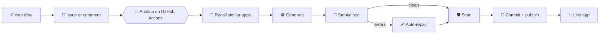

<div align="center">


<a href="https://suryasticsai.github.io/Ariotica/">
  
</a>

<br/>

[](https://suryasticsai.github.io/Ariotica/)
[](https://github.com/suryasticsai/Ariotica/issues/new)


</div>

---

## ⚡ The idea

Most AI coding tools hand you a platform to install, a subscription to pay, or a terminal to babysit.

**Ariotica hands you a folder.**

You open a GitHub issue. A workflow wakes up, writes the app, runs it, fixes what breaks, scans it, and commits the result. You talk to it afterwards by replying to the same issue. The repo is the interface, the runtime, the memory and the delivery address.

> **A chatbot gives you code to copy. Ariotica gives you a commit.**

---

## 🎛️ Run it from a comment

Everything is driven from **GitHub Issues**, where you already work.

| You write | Ariotica does |
|:--|:--|
| Issue title `[BUILD] habit-tracker`, with the idea in the body | 🏗️ Builds a new single-file app |
| `[improve] add dark mode` | ✨ Upgrades the existing app, keeping what works |
| `[fix] cards don't save` | 🩹 Patches the bug |
| `[fix] fix those scanner issues` | 🔎 Re-scans the code and fixes the findings |
| `[audit]` | 🛡️ Reviews security and repairs what it can |
| `[ask] which provider built habit-tracker?` | 🧠 Answers from the repo's code, apps and issue history, citing file and line |
| `[delete]` | 🗑️ Removes the app |

Put the tag at the start or the end of your comment. Quote-reply works. Comments without a tag are ignored, and only repo collaborators can trigger a run.

While it works, Ariotica keeps **one live comment** updated with each step and its timing, then replaces it with the result and closes the issue.

---

## 🔁 What happens after you press enter



**Write → Run → Repair → Scan → Ship.** The generated app is loaded in a headless DOM, every button is pressed once, and uncaught errors go back to the model for one repair round before anything is committed. It isn't magic, and it is not a substitute for human review of critical software.

---

## 🧬 What makes it different

| | **Ariotica** | Typical alternatives |
|:--|:--|:--|
| **Where it runs** | Your own GitHub Actions | Hosted SaaS, a Docker runtime, or your local terminal |
| **What you operate** | Nothing: no server, no database, no container | A platform, an account, or a Python environment |
| **Interface** | Issues and comments | Web UI, IDE, or CLI |
| **Models** | Your keys, with automatic fallback across providers | Often one default provider or one plan |
| **Memory** | Built-in BM25 search over your repo and issue history, no vector DB | A vector store, a closed index, or none |
| **Verification** | Runtime smoke test and static scan before every commit | Varies by tool |
| **Output** | Complete single-file vanilla JS apps | Patches to any codebase |

That last row is also the honest limit: Ariotica is a **small-app factory**, not a refactoring agent for a large codebase. Tools like GitHub's Copilot coding agent, OpenHands and Aider are the right choice for that. Ariotica is for when you want a working app from one sentence and nothing to install.

---

## 🧠 Under the hood

<details>
<summary><b>Provider chain, so one dead API never stops a build</b></summary>

<br/>

Providers are tried in order, and any without a key are skipped instantly:

`Groq → OpenRouter → Pollinations → Hugging Face`

- Pollinations needs no key, so a build can still run with an empty secrets page.
- 401, 402, 403, 404 and 429 errors are not retried, because retrying cannot fix them.
- Every provider has its own timeout, and the step list shows how long each attempt took.
- Reorder or pin providers with the `PROVIDER_ORDER` repository variable, and pin models with `GROQ_MODEL`, `OPENROUTER_MODEL` or `HF_MODEL`.
- Free tiers have quotas and some providers change their terms, so check each provider's current limits.

</details>

<details>
<summary><b>Zero-database repo memory (RAG)</b></summary>

<br/>

`lib/rag.js` is a dependency-free BM25 search engine in about 150 lines, with code-aware tokenizing (camelCase, snake_case, paths), line-accurate chunks and per-file diversity. It indexes:

- every source file and generated app,
- `projects.json`, so the agent knows what it built, when, and with which provider,
- issue and comment history.

`[ask]` answers use only the retrieved context, cite `path:lines`, and say so when the repo doesn't contain the answer. The same index is published as `knowledge/index.json` for the dashboard chat.

</details>

<details>
<summary><b>Quality gates</b></summary>

<br/>

1. The model replies with JSON, so code is separated from chatter. Truncated output is rejected.
2. A vanilla check rejects frameworks, CDNs and external URLs. Comments don't trigger false alarms.
3. A jsdom smoke test loads the app, fills inputs, presses buttons and collects uncaught errors.
4. One automatic repair round. If the repair makes things worse, the original is kept.
5. ESLint plus custom security patterns (and `sparrow-sast` when available), with the findings reported on the issue.
6. The commit, manifest update and knowledge-index refresh.

</details>

<details>
<summary><b>Project layout</b></summary>

<br/>

```text
generate.js          the agent: inputs, pipeline, status comment, [ask]
build-index.js       builds knowledge/index.json on demand
lib/providers.js     multi-provider LLM client with fallback
lib/rag.js           BM25 search (runs in Node and in the browser)
lib/knowledge.js     what the agent knows: files, manifest, issues
lib/scan.js          static security scanners
lib/smoke.js         jsdom runtime test
lib/text.js          parsing and validation helpers
projects/            the apps it has built
projects.json        manifest of every build
```

</details>

---

## 🚀 Give it a home in your GitHub

1. **Fork** this repository.
2. Under **Settings → Actions → General**, set workflow permissions to **Read and write**.
3. Under **Settings → Secrets and variables → Actions**, add one or more keys: `GROQ_API_KEY`, `OPENROUTER_API_KEY`, `HF_TOKEN`. None are required, because Pollinations works without a key.
4. Turn on **GitHub Pages** from the `main` branch for the dashboard.
5. Open an issue titled `[BUILD] calculator` and describe what you want.

No Python environment, no Docker image, no server fleet.

> **Security note:** The dashboard's Direct mode uses a GitHub personal access token. Treat it like a password, give it fine-grained permissions on this repo only, and never commit it. Issue mode needs no token.

---

<div align="center">

## ☀️ The human behind the agent

<a href="https://github.com/suryasticsai">
  
</a>

**Surya** · [@suryasticsai](https://github.com/suryasticsai)

*AI toolmaker · independent developer · automation architect*

> "I didn't want another AI that tells me how to write code.
> I wanted one that actually does the work."

<br/>

[](https://github.com/suryasticsai)
[](https://www.linkedin.com/in/suryasticsai)
[](https://suryasticsai.medium.com/)
[](https://huggingface.co/Suryasticsai)
[](https://suryasticsai.8b.io/)
[](https://alkembic.netlify.app/)

<br/>

**The agent writes software. The human wrote the agent.**

<sub>Built with JavaScript. Powered by GitHub. Designed to ship. © 2026 Surya</sub>


</div>
