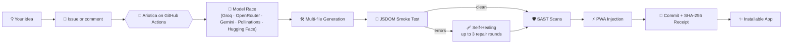

[](https://suryasticsai.github.io/Ariotica/)
[](https://github.com/suryasticsai/Ariotica/issues/new)


---

⚡ The idea

Most AI coding tools hand you a platform to install, a subscription to pay, or a terminal to babysit.

Ariotica hands you a folder.

You open a GitHub issue. A workflow wakes up, fires the prompt at multiple LLMs simultaneously, grabs the first successful result, writes a multi-file app, tests it in a headless browser, automatically repairs its own bugs, injects PWA support so you can install it on your phone, and cryptographically signs the commit.

> A chatbot gives you code to copy. Ariotica gives you a deployed, self-healing, installable application.

---

🎛️ Run it from a comment

Everything is driven from GitHub Issues, where you already work.

You write	Ariotica does	
Issue title `[BUILD] habit-tracker`, with the idea in the body	🏗️ Builds a new multi-file app (`index.html`, `style.css`, `script.js`)	
`[improve] add dark mode`	✨ Upgrades the existing app, keeping what works	
`[fix] cards don't save`	🩹 Patches the bug and re-runs the smoke test	
`[fix] fix those scanner issues`	🔎 Re-scans the code and fixes the findings	
`[audit]`	🛡️ Reviews security and repairs what it can	
`[ask] which provider built habit-tracker?`	🧠 Answers from the repo's code, apps and issue history, citing file and line	
`[delete]`	🗑️ Removes the app	

Put the tag at the start or the end of your comment. Quote-reply works. Comments without a tag are ignored, and only repo collaborators can trigger a run.

While it works, Ariotica keeps one live comment updated with each step and its timing, then replaces it with the result and closes the issue.

---

🔁 What happens after you press enter



Race → Write → Test → Repair (up to 3x) → Scan → PWA → Sign.

The generated app is loaded in a headless DOM, every button is pressed once, and uncaught errors go back to the model for up to three repair rounds before anything is committed.

---

🧬 What makes it different

	Ariotica	Typical alternatives	
Where it runs	Your own GitHub Actions	Hosted SaaS, a Docker runtime, or your local terminal	
What you operate	Nothing: no server, no database, no container	A platform, an account, or a Python environment	
Interface	Issues and comments	Web UI, IDE, or CLI	
Models	Parallel race across Groq, OpenRouter, Gemini, Pollinations and Hugging Face — first to pass wins	One default provider or one plan	
Memory	Built-in BM25 search over your repo and issue history, no vector DB	A vector store, a closed index, or none	
Verification	Cryptographic SHA-256 receipts + JSDOM runtime testing + SAST	Varies by tool	
Output	Multi-file architectures (`html`/`css`/`js`) wrapped in an installable PWA	Patches to any codebase	

That last row is also the honest limit: Ariotica is a small-app factory, not a refactoring agent for a large codebase. Tools like GitHub's Copilot coding agent, OpenHands and Aider are the right choice for that. Ariotica is for when you want a fully functional, offline-capable app from one sentence and nothing to install.

---

🧠 Under the hood

Instead of trying one provider, waiting for it to fail, and trying the next, Ariotica fires the request at multiple providers simultaneously.

- The first provider to return a valid, passing app wins.
- The losing requests are instantly cancelled to save API limits.
- Providers are tried in order: Groq → OpenRouter → Gemini → Pollinations → Hugging Face.
- If Groq goes down, the next provider takes the win in seconds instead of you waiting through a timeout.
- Set `RACE_SIZE=2` (or higher) in your repo variables to control how many race at once.

`lib/rag.js` is a dependency-free BM25 search engine in about 150 lines, with code-aware tokenizing (camelCase, snake_case, paths), line-accurate chunks and per-file diversity. It indexes:

- every source file and generated app,
- `projects.json`, so the agent knows what it built, when, and with which provider,
- issue and comment history.

`[ask]` answers use only the retrieved context, cite `path:line`, and say so when the repo doesn't contain the answer. The same index is published as `knowledge/index.json` for the dashboard chat.

1. The model replies with a strict JSON object containing `index.html`, `style.css`, and `script.js`. No markdown chatter.
2. A vanilla check rejects frameworks, CDNs and external URLs.
3. A jsdom smoke test loads the app, fills inputs, presses buttons and collects uncaught errors.
4. Self-Healing: If the app crashes, the error is fed back to the AI. It loops up to 3 times to fix its own bugs, accepting only a strictly better result.
5. ESLint plus custom security patterns scan the merged HTML.
6. PWA Injection: A post-processing script adds a manifest and service worker, making the app installable on iOS/Android.
7. Build Receipts: The workflow generates a `receipts/<app>.json` file containing a SHA-256 hash of every generated file. Run `node verify-receipt.js <app>` locally to prove the AI's output hasn't been tampered with.

```text
generate.js          the agent: inputs, pipeline, model race, self-healing, PWA
verify-receipt.js    CLI tool to verify SHA-256 hashes of generated apps
lib/providers.js     parallel multi-provider LLM client
lib/rag.js           BM25 search (runs in Node and in the browser)
lib/knowledge.js     what the agent knows: files, manifest, issues
lib/scan.js          static security scanners
lib/smoke.js         jsdom runtime test
lib/receipt.js       cryptographic hashing logic
projects/            the apps it has built (index.html, style.css, script.js, meta.json)
receipts/            the cryptographic proof of every build
projects.json        manifest of every build
```

---

🚀 Give it a home in your GitHub

1. Fork this repository.
2. Under Settings → Actions → General, set workflow permissions to Read and write.
3. Under Settings → Secrets and variables → Actions, add one or more keys: `GROQ_API_KEY`, `OPENROUTER_API_KEY`, `HF_TOKEN`. None are strictly required — Pollinations works without a key.
4. Turn on GitHub Pages from the `main` branch for the premium dashboard.
5. Open an issue titled `[BUILD] calculator` and describe what you want.

No Python environment, no Docker image, no server fleet.

> Security note: The dashboard's Direct mode uses a GitHub personal access token. Treat it like a password, give it fine-grained permissions on this repo only, and never commit it. Issue mode needs no token.

---

☀️ The human behind the agent

Surya · [@suryasticsai](https://github.com/suryasticsai)

AI toolmaker · independent developer · automation architect

"I didn't want another AI that tells me how to write code.
I wanted one that actually does the work."

[](https://github.com/suryasticsai)
[](https://www.linkedin.com/in/suryasticsai)
[](https://medium.com/@suryasticsai)
[](https://huggingface.co/suryasticsai)
[](https://suryasticsai.github.io)
[](https://alkembic.app)

The agent writes software. The human wrote the agent.

Built with JavaScript. Powered by GitHub. Designed to ship. © 2026 Surya