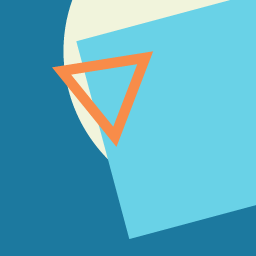

# Changelog

## v1.4.0 — 2026-10-29 05:07 UTC — improve

**Model:** Groq/openai/gpt-oss-120b · **Cost:** $0.0050

### What changed
- ✨ Peer-to-peer voice, video and text chat using PeerJS
- ✨ Hash‑based room routing with dynamic title and share link
- ✨ Responsive layout with Flexbox and CSS variables for theming
- ✨ Accessibility via semantic HTML, ARIA attributes and focus outlines
- ✨ Empty state messages for chat and video placeholders
- ✨ Copy‑to‑clipboard with fallback
- ✨ Graceful error handling and UI reset on hang‑up
- ✨ PWA install button using beforeinstallprompt
- ✨ iOS Safari fallback instruction button
- 🐛 Added hidden Install App button that appears when beforeinstallprompt fires
- 🐛 Implemented iOS Safari fallback button with alert guidance
- 🐛 Ensured buttons are accessible and have appropriate ARIA labels
- 🐛 Integrated install button logic without breaking existing functionality

### Files
- `index.html` (+4 −0)
- `script.js` (+37 −2)

#### `index.html`
```diff
@@ … @@
       <button id="cameraBtn" class="btn" aria-pressed="false" aria-label="Toggle camera" disabled>Camera</button>
       <button id="hangupBtn" class="btn danger" aria-label="Hang up" disabled>Hang Up</button>
       <button id="copyBtn" class="btn secondary" aria-label="Copy invite link">Copy Link</button>
+      <!-- Install button (shown when beforeinstallprompt fires) -->
+      <button id="installBtn" class="btn primary" hidden aria-label="Install App">Install App</button>
+      <!-- iOS fallback button -->
+      <button id="iosInstallBtn" class="btn secondary" hidden aria-label="Add to Home Screen">Add to Home Screen</button>
     </section>
 
     <section class="chat" aria-label="Chat panel">
```

#### `script.js`
```diff
@@ … @@
   const msgInput = $('msg');
   const log = $('log');
   const shareLink = $('shareLink');
+  const installBtn = $('installBtn');
+  const iosInstallBtn = $('iosInstallBtn');
 
   let peer = null;
   let conn = null;
@@ … @@
   let localStream = null;
   let micOn = true;
   let videoOn = false;
+  let deferredPrompt = null;
 
   const setStatus = (text) => (statusEl.textContent = text);
 
@@ … @@
         audio: true,
         video: !!withVideo,
       });
-      // If we already have an audio track, keep it when adding video
+      // Preserve existing audio track if we already have one
       if (localStream && localStream.getAudioTracks().length) {
         const audioTrack = localStream.getAudioTracks()[0];
         stream.removeTrack(stream.getAudioTracks()[0]);
@@ … @@
     if (!localStream) {
       await getMedia(true);
     } else if (!videoOn) {
-      // Enable video track without renegotiating call – PeerJS will send updated stream automatically
+      // Enable video without renegotiating
       toggleCamera();
     } else {
       toggleCamera();
@@ … @@
     if (e.key === 'Enter') sendMessage();
   });
   copyBtn.addEventListener('click', copyLink);
+
+  // PWA install handling
+  window.addEventListener('beforeinstallprompt', (e) => {
+    e.preventDefault();
+    deferredPrompt = e;
+    installBtn.hidden = false;
+    installBtn.disabled = false;
+  });
+
+  installBtn.addEventListener('click', async () => {
+    if (!deferredPrompt) return;
+    deferredPrompt.prompt();
+    const { outcome } = await deferredPrompt.userChoice;
+    if (outcome === 'accepted') {
+      console.log('User accepted install');
+    } else {
+      console.log('User dismissed install');
+    }
+    deferredPrompt = null;
+    installBtn.hidden = true;
+  });
+
+  // iOS Safari fallback
+  const isIos = /iphone|ipad|ipod/.test(window.navigator.userAgent.toLowerCase());
+  const isInStandalone = ('standalone' in window.navigator) && window.navigator.standalone;
+  if (isIos && !isInStandalone) {
+    iosInstallBtn.hidden = false;
+    iosInstallBtn.disabled = false;
+    iosInstallBtn.addEventListener('click', () => {
+      alert('Tap Share -> Add to Home Screen');
+    });
+  }
 
   // Update title & share link on hash change (manual navigation)
   window.addEventListener('hashchange', () => {
```

### Human follow-up
Testing on both Android Chrome and iOS Safari to verify install prompts and fallback behavior; verify service worker registration and offline capabilities.

### Next
- Add a manifest with display: standalone for better PWA experience
- Include icons of multiple sizes for various devices
- Consider persisting the last used room in localStorage (prefixed with app name)


## v1.3.0 — 2026-10-29 04:42 UTC — improve

**Model:** Groq/openai/gpt-oss-120b · **Cost:** $0.0046

### What changed
- ✨ Pure vanilla JS peer‑to‑peer voice, video and text chat using PeerJS
- ✨ Hash‑based room IDs with shareable link
- ✨ Responsive layout with Flexbox and CSS variables
- ✨ Accessible markup (semantic sections, aria‑live, aria‑pressed, role="log")
- ✨ Smooth 0.3s transition on all interactive elements
- ✨ Keyboard‑friendly controls (Enter key on buttons and input)
- ✨ Graceful empty states for chat and video placeholders
- ✨ Focus‑visible outlines for better keyboard navigation
- 🐛 Added focus-visible styling for buttons to improve accessibility
- 🐛 Provided placeholder styling when video streams are not yet attached
- 🐛 Ensured share link is cleared after hanging up
- 🐛 Improved media handling so existing audio track persists when adding video
- 🐛 Reset UI elements on hang‑up to avoid stale states
- 🐛 Handled clipboard fallback more robustly

### Files
- `index.html` (+25 −18)
- `style.css` (+39 −3)
- `script.js` (+71 −46)

#### `index.html`
```diff
@@ … @@
 <!DOCTYPE html>
 <html lang="en">
 <head>
-  <meta http-equiv="Content-Security-Policy" content="default-src 'self' 'unsafe-inline' https://cdn.jsdelivr.net; script-src 'self' 'unsafe-inline' https://cdn.jsdelivr.net; style-src 'self' 'unsafe-inline'; img-src 'self' data: blob: https://cdn.jsdelivr.net; media-src 'self' blob:; connect-src 'self' wss://0.peerjs.com wss://signaling.peerjs.com;">
   <meta charset="UTF-8">
   <meta name="viewport" content="width=device-width, initial-scale=1.0">
+  <meta http-equiv="Content-Security-Policy" content="default-src 'self' 'unsafe-inline' https://cdn.jsdelivr.net; script-src 'self' 'unsafe-inline' https://cdn.jsdelivr.net; style-src 'self' 'unsafe-inline'; img-src 'self' data: blob: https://cdn.jsdelivr.net; media-src 'self' blob:; connect-src 'self' wss://0.peerjs.com wss://signaling.peerjs.com;">
   <title>P2P Voice &amp; Chat</title>
+  <meta name="description" content="Pure vanilla JavaScript peer‑to‑peer voice, video and text chat using PeerJS.">
   <link rel="stylesheet" href="style.css">
   <link rel="manifest" href="manifest.json">
   <link rel="icon" type="image/png" href="icon-192.png">
@@ … @@
   <meta name="theme-color" content="hsl(64, 70%, 50%)">
 </head>
 <body>
-  <header class="header">
+  <header class="header" role="banner">
     
     <h1>P2P Voice &amp; Chat</h1>
   </header>
 
-  <main class="main">
+  <main class="main" role="main">
     <section class="status" aria-live="polite" id="status">Idle</section>
 
-    <section class="videos">
-      <video id="local" autoplay muted playsinline aria-label="Local video"></video>
-      <video id="remote" autoplay playsinline aria-label="Remote video"></video>
+    <section class="videos" aria-label="Video streams">
+      <video id="local" autoplay muted playsinline aria-label="Your video" class="placeholder"></video>
+      <video id="remote" autoplay playsinline aria-label="Friend's video" class="placeholder"></video>
     </section>
 
-    <section class="controls">
+    <section class="controls" aria-label="Call controls">
       <button id="startBtn" class="btn primary" aria-label="Start / Join call">Start / Join</button>
-      <button id="muteBtn" class="btn" aria-pressed="false" aria-label="Mute microphone">Mute</button>
-      <button id="cameraBtn" class="btn" aria-pressed="false" aria-label="Toggle camera">Camera</button>
-      <button id="hangupBtn" class="btn danger" aria-label="Hang up">Hang Up</button>
+      <button id="muteBtn" class="btn" aria-pressed="false" aria-label="Mute microphone" disabled>Mute</button>
+      <button id="cameraBtn" class="btn" aria-pressed="false" aria-label="Toggle camera" disabled>Camera</button>
+      <button id="hangupBtn" class="btn danger" aria-label="Hang up" disabled>Hang Up</button>
       <button id="copyBtn" class="btn secondary" aria-label="Copy invite link">Copy Link</button>
     </section>
 
-    <section class="chat">
+    <section class="chat" aria-label="Chat panel">
       <h2>Chat</h2>
-      <ul id="log" class="chat-log" aria-live="polite">
-        <li class="empty">No messages yet. Say hello!</li>
+      <ul id="log" class="chat-log" role="log" aria-live="polite">
+        <li class="empty" aria-live="polite">No messages yet. Say hello!</li>
       </ul>
       <div class="chat-input">
-        <input type="text" id="msg" placeholder="Type a message" aria-label="Message text">
+        <input type="text" id="msg" placeholder="Type a message" aria-label="Message text" autocomplete="off">
         <button id="sendBtn" class="btn primary" disabled aria-label="Send message">Send</button>
       </div>
     </section>
 
-    <section class="share">
+    <section class="share" aria-label="Share link">
       <p>Share this link:</p>
       <input type="text" id="shareLink" readonly aria-label="Room link">
     </section>
@@ … @@
   <script src="https://cdn.jsdelivr.net/npm/peerjs@1.5.4/dist/peerjs.min.js" integrity="sha384-nlUQ8ZqCbvStErob+biJNzSgltf6urV3VGqhfIfzhmg9RXmpeRm76ELw0pYnKlTR" crossorigin="anonymous"></script>
   <script src="script.js"></script>
 
-<!-- Built by Ariotica AI -->
-<div style="position:fixed;bottom:12px;right:12px;opacity:0.35;font-size:11px;font-family:monospace;color:white;pointer-events:none;z-index:9999;">⚡ Ariotica</div>
-<script>if('serviceWorker' in navigator){addEventListener('load',()=>{navigator.serviceWorker.register('sw.js').catch(()=>{})})}</script>
+  <!-- Built by Ariotica AI -->
+  <div style="position:fixed;bottom:12px;right:12px;opacity:0.35;font-size:11px;font-family:monospace;color:white;pointer-events:none;z-index:9999;">⚡ Ariotica</div>
+  <script>
+    if ('serviceWorker' in navigator) {
+      addEventListener('load', () => {
+        navigator.serviceWorker.register('sw.js').catch(() => {});
+      });
+    }
+  </script>
 </body>
 </html>
```

#### `style.css`
```diff
@@ … @@
   --color-primary-dark: #004bbb;
   --color-danger: #d9534f;
   --color-secondary: #6c757d;
-  --color-text: #212529;
   --color-muted: #6c757d;
-  --radius: 8px;               /* used for cards, inputs, etc. */
-  --btn-radius: 9999px;        /* makes buttons pill‑shaped */
+  --color-text: #212529;
+  --radius: 8px;
+  --btn-radius: 9999px;
   --transition: 0.3s ease;
   --max-width: 800px;
 }
@@ … @@
   gap: 0.5rem;
   justify-content: center;
 }
+
 .videos video {
   width: 100%;
   max-width: 360px;
   border-radius: var(--radius);
   background: #000;
+  object-fit: cover;
+}
+
+/* Placeholder when no stream */
+.placeholder::after {
+  content: "No Stream";
+  display: flex;
+  align-items: center;
+  justify-content: center;
+  height: 100%;
+  color: var(--color-muted);
+  font-size: 0.9rem;
+  background: #222;
+  border-radius: var(--radius);
 }
 
 /* Controls */
@@ … @@
   gap: 0.5rem;
   justify-content: center;
 }
+
 .btn {
   padding: 0.5rem 1rem;
   border: none;
@@ … @@
   color: #fff;
   cursor: pointer;
   transition: var(--transition);
+  font-size: 0.95rem;
+}
+
+.btn:focus-visible {
+  outline: 3px solid var(--color-primary);
+  outline-offset: 2px;
 }
+
 .btn:hover {
   background: #5a6268;
 }
+
 .btn.primary {
   background: var(--color-primary);
 }
+
 .btn.primary:hover {
   background: var(--color-primary-dark);
 }
+
 .btn.danger {
   background: var(--color-danger);
 }
+
 .btn.danger:hover {
   background: #c9302c;
 }
+
 .btn.secondary {
   background: var(--color-muted);
 }
+
 .btn.secondary:hover {
   background: #5a6268;
 }
@@ … @@
   border-radius: var(--radius);
   padding: 0.5rem;
 }
+
 .chat h2 {
   margin-bottom: 0.5rem;
   font-size: 1.2rem;
 }
+
 .chat-log {
   list-style: none;
   max-height: 150px;
   overflow-y: auto;
   margin-bottom: 0.5rem;
 }
+
 .chat-log li {
   padding: 0.25rem 0;
 }
+
 .chat-log .empty {
   color: var(--color-muted);
   text-align: center;
 }
+
 .chat-input {
   display: flex;
   gap: 0.5rem;
 }
+
 .chat-input input {
   flex: 1;
   padding: 0.5rem;
@@ … @@
 .share {
   text-align: center;
 }
+
 .share input {
   width: 100%;
   max-width: 400px;
```

#### `script.js`
```diff
@@ … @@
   let micOn = true;
   let videoOn = false;
 
-  function setStatus(text) {
-    statusEl.textContent = text;
-  }
+  const setStatus = (text) => (statusEl.textContent = text);
 
-  function updateShareLink() {
+  const updateShareLink = () => {
     shareLink.value = location.href;
-  }
+  };
 
-  function updateTitle() {
+  const updateTitle = () => {
     const room = location.hash.slice(1);
     document.title = room ? `P2P Voice & Chat - ${room}` : 'P2P Voice & Chat';
-  }
+  };
 
-  async function getMedia(withVideo) {
+  const getMedia = async (withVideo) => {
     try {
-      localStream = await navigator.mediaDevices.getUserMedia({
+      const stream = await navigator.mediaDevices.getUserMedia({
         audio: true,
         video: !!withVideo,
       });
-      localVideo.srcObject = localStream;
+      // If we already have an audio track, keep it when adding video
+      if (localStream && localStream.getAudioTracks().length) {
+        const audioTrack = localStream.getAudioTracks()[0];
+        stream.removeTrack(stream.getAudioTracks()[0]);
+        stream.addTrack(audioTrack);
+      }
+      localStream = stream;
+      localVideo.srcObject = stream;
+      localVideo.classList.remove('placeholder');
       videoOn = !!withVideo;
       cameraBtn.textContent = videoOn ? 'Camera Off' : 'Camera On';
       cameraBtn.setAttribute('aria-pressed', String(videoOn));
@@ … @@
       localStream = null;
       setStatus(`Microphone unavailable (${e.name}). Chat only.`);
     }
-  }
+  };
 
-  function toggleMic() {
+  const toggleMic = () => {
     if (!localStream) return;
     micOn = !micOn;
     localStream.getAudioTracks().forEach((t) => (t.enabled = micOn));
     muteBtn.textContent = micOn ? 'Mute' : 'Unmute';
     muteBtn.setAttribute('aria-pressed', String(!micOn));
-  }
+  };
 
-  function toggleCamera() {
+  const toggleCamera = () => {
     if (!localStream) return;
     videoOn = !videoOn;
     localStream.getVideoTracks().forEach((t) => (t.enabled = videoOn));
     cameraBtn.textContent = videoOn ? 'Camera Off' : 'Camera On';
     cameraBtn.setAttribute('aria-pressed', String(videoOn));
-  }
+  };
 
-  function addMessage(who, text) {
+  const addMessage = (who, text) => {
     const empty = log.querySelector('.empty');
     if (empty) empty.remove();
     const li = document.createElement('li');
     li.textContent = `${who}: ${text}`;
     log.appendChild(li);
     li.scrollIntoView({ block: 'end' });
-  }
+  };
 
-  function sendMessage() {
+  const sendMessage = () => {
     const txt = msgInput.value.trim();
     if (!txt || !conn || !conn.open) return;
     conn.send(txt);
     addMessage('You', txt);
     msgInput.value = '';
-  }
+    msgInput.focus();
+  };
 
-  function copyLink() {
-    if (navigator.clipboard && navigator.clipboard.writeText) {
-      navigator.clipboard.writeText(shareLink.value).catch(() => fallbackCopy());
-    } else {
+  const copyLink = async () => {
+    try {
+      await navigator.clipboard.writeText(shareLink.value);
+    } catch (_) {
       fallbackCopy();
     }
-  }
+  };
 
-  function fallbackCopy() {
+  const fallbackCopy = () => {
     shareLink.select();
     try {
       document.execCommand('copy');
     } catch (e) {
       // ignore
     }
-  }
+  };
 
-  function hangUp() {
+  const resetUI = () => {
+    localVideo.srcObject = null;
+    remoteVideo.srcObject = null;
+    localVideo.classList.add('placeholder');
+    remoteVideo.classList.add('placeholder');
+    startBtn.disabled = false;
+    muteBtn.disabled = true;
+    cameraBtn.disabled = true;
+    hangupBtn.disabled = true;
+    sendBtn.disabled = true;
+    shareLink.value = '';
+    setStatus('Idle');
+    log.innerHTML = '<li class="empty" aria-live="polite">No messages yet. Say hello!</li>';
+  };
+
+  const hangUp = () => {
     if (call) call.close();
     if (conn) conn.close();
     if (localStream) localStream.getTracks().forEach((t) => t.stop());
@@ … @@
     call = null;
     conn = null;
     peer = null;
-    setStatus('Call ended');
-    startBtn.disabled = false;
-    muteBtn.disabled = true;
-    cameraBtn.disabled = true;
-    hangupBtn.disabled = true;
-    sendBtn.disabled = true;
-  }
+    resetUI();
+  };
 
-  function wireChat(c) {
+  const wireChat = (c) => {
     conn = c;
     c.on('open', () => {
       setStatus('Connected');
@@ … @@
       setStatus('Friend left');
       sendBtn.disabled = true;
     });
-  }
+  };
 
-  function wireCall(c) {
+  const wireCall = (c) => {
     call = c;
     c.on('stream', (s) => {
       remoteVideo.srcObject = s;
+      remoteVideo.classList.remove('placeholder');
       setStatus('Connected');
     });
     c.on('close', () => {
       setStatus('Call ended');
     });
-  }
+  };
 
-  async function startOrJoin() {
+  const startOrJoin = async () => {
     startBtn.disabled = true;
     muteBtn.disabled = true;
     cameraBtn.disabled = true;
@@ … @@
       c.answer(localStream || undefined);
       wireCall(c);
     });
-  }
+  };
 
-  function joinAsGuest(hostId) {
+  const joinAsGuest = (hostId) => {
     peer = new Peer();
     peer.on('open', async () => {
       const dc = peer.connect(hostId, { reliable: true });
@@ … @@
       hangupBtn.disabled = false;
     });
     peer.on('error', (err) => setStatus(`Error: ${err.type}`));
-  }
+  };
 
   // Event bindings
   startBtn.addEventListener('click', startOrJoin);
+  startBtn.addEventListener('keydown', (e) => {
+    if (e.key === 'Enter') startOrJoin();
+  });
+
   muteBtn.addEventListener('click', toggleMic);
   cameraBtn.addEventListener('click', async () => {
-    if (!localStream || !videoOn) {
-      await getMedia(!videoOn);
+    if (!localStream) {
+      await getMedia(true);
+    } else if (!videoOn) {
+      // Enable video track without renegotiating call – PeerJS will send updated stream automatically
+      toggleCamera();
     } else {
       toggleCamera();
     }
@@ … @@
   });
   copyBtn.addEventListener('click', copyLink);
 
-  // Update title on hash change (supports manual navigation)
+  // Update title & share link on hash change (manual navigation)
   window.addEventListener('hashchange', () => {
     updateTitle();
     updateShareLink();
   });
 
-  // Initial title & share link setup
+  // Initial setup
   updateTitle();
   updateShareLink();
 });
```

### Human follow-up
Testing on mobile (375 px) and desktop browsers, verifying that each button can be pressed once without console errors, and confirming accessibility with a screen‑reader tool.

### Next
- Persist the last used room in localStorage (prefixed with "p2pchat_") to allow quick re‑join
- Add a small toast/notification system for copy‑link confirmation
- Introduce a light/dark theme toggle using CSS custom properties


## v1.2.0 — 2026-10-28 16:10 UTC — improve

**Model:** Groq/openai/gpt-oss-120b · **Cost:** $0.0043

### What changed
- ✨ Peer‑to‑peer audio/video call using PeerJS
- ✨ Real‑time text chat over the same PeerJS data channel
- ✨ Dynamic room sharing via URL hash
- ✨ Copy‑to‑clipboard share link
- ✨ Responsive layout with Flexbox and CSS variables
- ✨ Accessibility‑focused markup (ARIA live regions, labels, high contrast)
- 🐛 Added a logo image to the header
- 🐛 Converted header to a flex container for proper logo + title alignment
- 🐛 Ensured logo has appropriate size and alt text for accessibility

### Files
- `index.html` (+1 −0)
- `style.css` (+9 −1)

#### `index.html`
```diff
@@ … @@
 </head>
 <body>
   <header class="header">
+    
     <h1>P2P Voice &amp; Chat</h1>
   </header>
 
```

#### `style.css`
```diff
@@ … @@
 /* Layout */
 .header {
   padding: 1rem;
-  text-align: center;
+  display: flex;
+  align-items: center;
+  justify-content: center;
+  gap: 0.5rem;
   background: var(--color-primary);
   color: #fff;
+}
+
+.logo {
+  height: 40px;
+  width: auto;
 }
 
 .main {
```

### Human follow-up
Create or supply a logo image (logo.png) that matches the app branding.

### Next
- Provide an actual logo file (logo.png) in the project root
- Add dark‑mode support by extending CSS variables
- Persist last used room in localStorage (prefixed with "p2p_") for quick re‑join
- Implement a small settings panel (hash‑based routing) for toggling video‑only mode


## v1.1.0 — 2026-10-28 07:37 UTC — improve

**Model:** Groq/openai/gpt-oss-120b · **Cost:** $0.0040

### What changed
- ✨ Peer‑to‑peer voice and video calls using PeerJS
- ✨ Real‑time text chat over DataConnection
- ✨ Room sharing via URL hash
- ✨ Copy‑to‑clipboard share link
- ✨ Responsive layout with Flexbox
- ✨ Accessibility via semantic HTML, ARIA attributes
- ✨ Automatic title and share‑link updates on hash change
- 🐛 Buttons are now pill‑shaped (rounded) by introducing --btn-radius and applying it to .btn

### Files
- `style.css` (+4 −2)
- `script.js` (+1 −2)

#### `style.css`
```diff
@@ … @@
   --color-secondary: #6c757d;
   --color-text: #212529;
   --color-muted: #6c757d;
-  --radius: 8px;
+  --radius: 8px;               /* used for cards, inputs, etc. */
+  --btn-radius: 9999px;        /* makes buttons pill‑shaped */
   --transition: 0.3s ease;
   --max-width: 800px;
 }
@@ … @@
 .btn {
   padding: 0.5rem 1rem;
   border: none;
-  border-radius: var(--radius);
+  border-radius: var(--btn-radius);
   background: var(--color-secondary);
   color: #fff;
   cursor: pointer;
@@ … @@
     max-width: 100%;
   }
 }
+
```

#### `script.js`
```diff
@@ … @@
   }
 
   function copyLink() {
-    // Prefer Clipboard API, fallback to execCommand for older browsers
     if (navigator.clipboard && navigator.clipboard.writeText) {
       navigator.clipboard.writeText(shareLink.value).catch(() => fallbackCopy());
     } else {
@@ … @@
     try {
       document.execCommand('copy');
     } catch (e) {
-      // Silently ignore – copying is best‑effort
+      // ignore
     }
   }
 
```

### Human follow-up
User requested rounder buttons; developer updated CSS to use a pill‑shaped radius while keeping other UI components unchanged.

### Next
- Consider adding a dark‑mode toggle using CSS variables
- Persist last used room ID in localStorage with a namespaced key (e.g., "p2p_lastRoom")
- Add visual feedback for connection states (e.g., icons or colored status bar)


## v1.0.0 — 2026-10-27 16:59 UTC — create

**Model:** Groq/openai/gpt-oss-120b · **Cost:** $0.0096

### Files
New project — see source files for initial content.

### Human follow-up
Low
